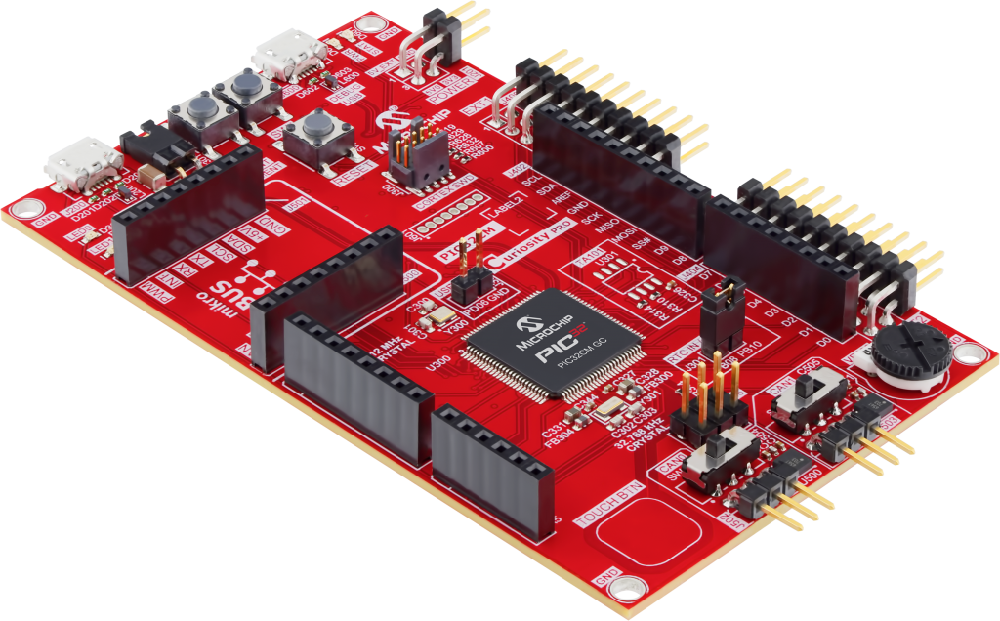
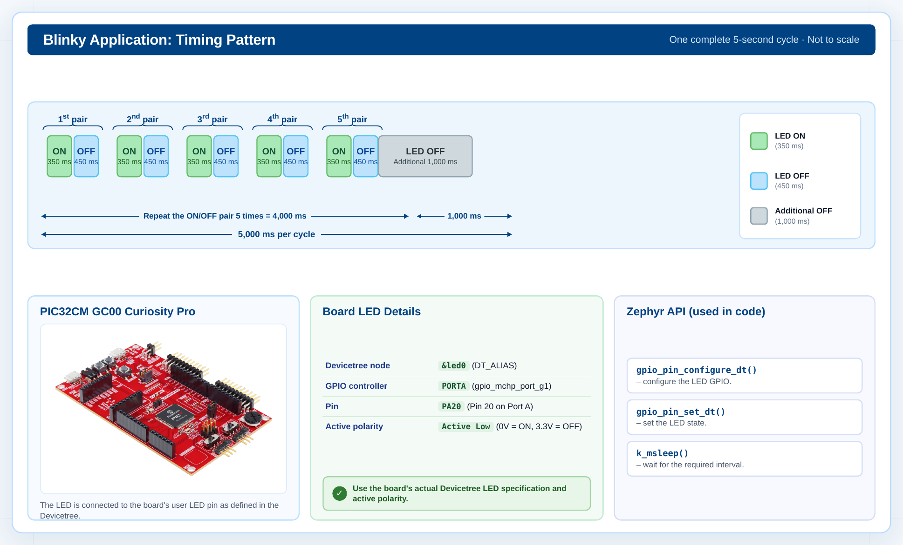
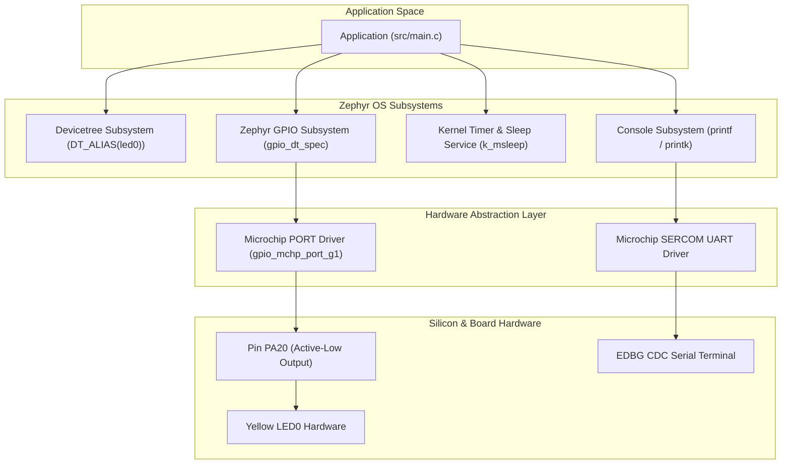
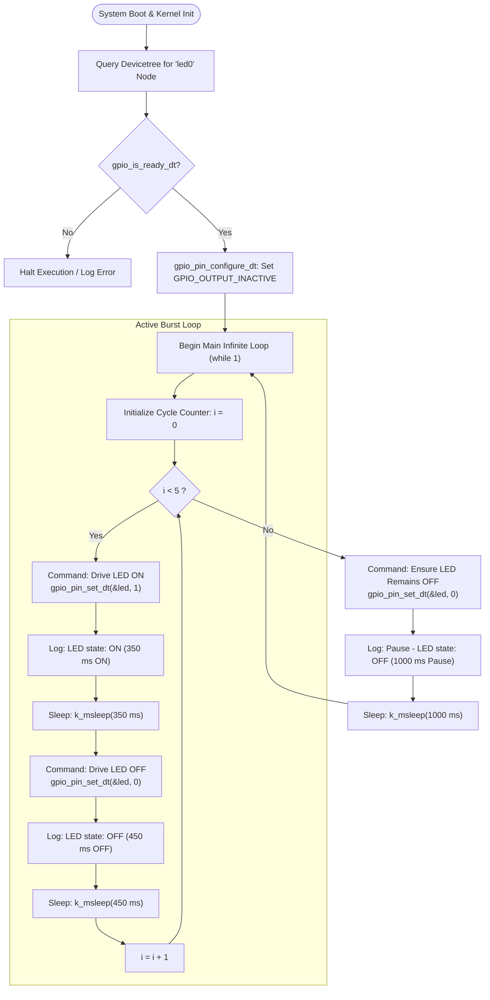
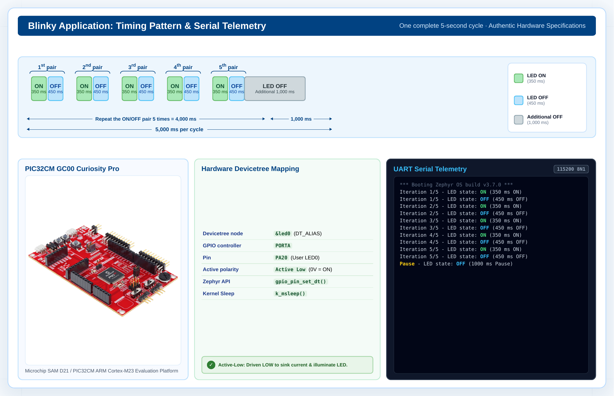

# PIC32CM GC00 Curiosity Pro — Custom Blinky Pattern Demo

[](https://zephyrproject.org/)
[](https://www.microchip.com/)
[](https://www.microchip.com/)
[](https://developer.arm.com/Processors/Cortex-M23)
[](LICENSE)

An enterprise-ready, standalone **Zephyr RTOS** demonstration application developed for the **Microchip PIC32CM GC00 Curiosity Pro** evaluation kit. The application drives the onboard user LED with a deterministic, repeating pulse pattern using Zephyr's Devicetree-driven GPIO subsystem.

> 🎓 **Complete Educational Course & Student Guide Available!**
> Looking for a thorough beginner tutorial? Read our **[Comprehensive Student & Beginner's Guide to Zephyr RTOS](STUDENT_GUIDE.md)** covering RTOS fundamentals, why Zephyr was created, active-low electrical logic, line-by-line code explanation, and hands-on lab challenges.

---

## Table of Contents

- [Student & Beginner Guide](STUDENT_GUIDE.md)

- [Overview](#overview)
- [Hardware Specifications](#hardware-specifications)
- [Pinout & Peripheral Mapping](#pinout--peripheral-mapping)
- [Timing Specifications & Waveform](#timing-specifications--waveform)
- [Software Architecture & Flowcharts](#software-architecture--flowcharts)
- [Project Structure](#project-structure)
- [Prerequisites & Environment Setup](#prerequisites--environment-setup)
- [Building and Flashing](#building-and-flashing)
- [Serial Console Output](#serial-console-output)
- [Troubleshooting & Diagnostics](#troubleshooting--diagnostics)
- [License](#license)

---

## Overview

This application implements a custom multi-phase blinking sequence:
1. **Active Phase**: The onboard Yellow LED0 pulses **5 times** in succession:
   - **ON Time**: $350\text{ ms}$
   - **OFF Time**: $450\text{ ms}$
2. **Rest Phase**: After 5 completed cycles, the LED enters a quiescent OFF state for **$1000\text{ ms}$ (1 second)**.
3. **Repeat**: The sequence repeats indefinitely within an asynchronous, non-blocking kernel sleep loop.

---

## Hardware Specifications

<p align="center">
  
</p>

| Parameter | Specification | Details |
| :--- | :--- | :--- |
| **Board Name** | PIC32CM GC00 Curiosity Pro | Evaluation Kit |
| **Board Target Identifier** | `pic32cm_gc00_cpro` | Zephyr Board ID |
| **Microcontroller (MCU)** | PIC32CM5112GC00100 | Microchip 32-bit MCU |
| **Core Architecture** | ARM Cortex-M23 | ARMv8-M Baseline |
| **CPU Clock Frequency** | $48\text{ MHz}$ | Internal FDPLL96M |
| **Flash Memory** | $512\text{ KB}$ | High-performance On-Chip Program Flash |
| **SRAM** | $128\text{ KB}$ | Zero-Wait-State System SRAM |
| **Onboard Debugger** | Microchip nEDBG / EDBG | CMSIS-DAP / Virtual COM / J-Link |
| **Supply Voltage** | $3.3\text{ V}$ | USB Powered ($5.0\text{ V} \rightarrow 3.3\text{ V}$ LDO) |

---

## Pinout & Peripheral Mapping

The PIC32CM GC00 Curiosity Pro routes dedicated user peripherals through Microchip's PORT controller. The table below specifies the hardware and Devicetree configuration used by this project:

| Signal Name | Physical MCU Pin | PORT Group / Pin | Electrical Polarity | Devicetree Alias | Function |
| :--- | :--- | :--- | :--- | :--- | :--- |
| **LED0** | Pin 39 | `PORTA[20]` | **Active-Low** (`GPIO_ACTIVE_LOW`) | `led0` | Yellow Status LED |
| **LED1** | Pin 37 | `PORTA[18]` | **Active-Low** (`GPIO_ACTIVE_LOW`) | `led1` | Secondary Yellow LED |
| **SW0** | Pin 43 | `PORTB[07]` | Active-Low (`GPIO_PULL_UP`) | `sw0` | User Mechanical Pushbutton |
| **SW1** | Pin 47 | `PORTB[11]` | Active-Low (`GPIO_PULL_UP`) | `sw1` | User Mechanical Pushbutton |
| **UART TX** | Pin 63 | `PORTA[04]` | Active-High | `chosen: zephyr,console` | EDBG CDC Virtual COM Port (115200 8N1) |

> **Note on Polarity:** Because the LED is wired in an **Active-Low** configuration (anode tied to $V_{DD}$, cathode driven by `PA20` through a ballast resistor), Zephyr's `GPIO_DT_SPEC_GET` abstracts the physical logic inversion automatically.

---

## Timing Specifications & Waveform

### Sequence Parameters

| Parameter | Constant Identifier | Value (ms) | Description |
| :--- | :--- | :--- | :--- |
| **Iteration Count** | — | `5 cycles` | Number of fast blink bursts per period |
| **Pulse Active (ON)** | `ON_TIME` | `350 ms` | Duration LED is illuminated |
| **Pulse Inactive (OFF)**| `OFF_TIME` | `450 ms` | Inter-pulse delay between consecutive bursts |
| **Burst Period** | `ON_TIME + OFF_TIME` | `800 ms` | Single pulse cycle period |
| **Total Burst Duration**| `5 * 800 ms` | `4000 ms` | Total time spent in the active 5-pulse sequence |
| **Quiescent Pause** | `SLEEP_TIME_MS` | `1000 ms` | Standby time during which LED is strictly OFF |
| **Total Super-Period** | — | `5000 ms` | Complete cycle duration ($4\text{ s} + 1\text{ s} = 5\text{ s}$) |

### Timing Waveform Diagram

<p align="center">
  
</p>

```text
       |<-- 800ms -->|
        350ms  450ms
       +-----+       +-----+       +-----+       +-----+       +-----+
LED ON |     |       |     |       |     |       |     |       |     |
       |     |       |     |       |     |       |     |       |     |
LED OFF+     +-------+     +-------+     +-------+     +-------+     +-----------------------+
        Burst 1       Burst 2       Burst 3       Burst 4       Burst 5     1000ms PAUSE (OFF)
       |=========================== 4000ms Burst ==========================|====== 1000ms ======|
       |<--------------------------------- 5000ms Full Period --------------------------------->|
```

---

## Software Architecture & Flowcharts

### System Block Diagram



### Execution Flowchart



---

## Project Structure

```text
pic32cm_gc00_blinky/
├── CMakeLists.txt        # Top-level Zephyr application build script
├── prj.conf              # Project-level Kconfig options & driver dependencies
├── README.md             # Enterprise documentation, diagrams & specifications
├── .gitignore            # Git exclusion rules for Zephyr build artifacts
└── src/
    └── main.c            # Application logic, timing macros & GPIO handlers
```

### File Manifest

| File | Type | Purpose |
| :--- | :--- | :--- |
| [`CMakeLists.txt`](CMakeLists.txt) | CMake Build File | Declares Zephyr package dependency and links `src/main.c`. |
| [`prj.conf`](prj.conf) | Kernel Configuration | Enables `CONFIG_GPIO=y`, `CONFIG_PRINTK=y`, and `CONFIG_STDOUT_CONSOLE=y`. |
| [`src/main.c`](src/main.c) | C Source File | Core firmware implementing the multi-stage pulse sequence. |
| [`.gitignore`](.gitignore) | Version Control | Prevents compiled artifacts (`build/`, `*.elf`, `*.hex`, `*.bin`) from polluting git history. |

---

## Prerequisites & Environment Setup

### Required Tools

| Tool | Recommended Version | Purpose |
| :--- | :--- | :--- |
| **Zephyr SDK** | `0.16.8` or newer | GNU Arm Embedded Toolchain (`arm-zephyr-eabi`) |
| **West Tool** | `1.2.0` or newer | Zephyr meta-tool for building and flashing |
| **Python** | `3.10+` | Build system runner and script host |
| **CMake** | `3.20.0+` | Low-level build definition engine |
| **Ninja** | `1.10+` | High-speed build engine |
| **J-Link / EDBG** | Latest | Hardware programming & in-circuit debugging |

### Environment Activation

```bash
# Navigate to your Zephyr workspace
cd ~/zephyrproject

# Activate Python virtual environment
source .venv/bin/activate
```

---

## Building and Flashing

### Command Matrix

| Action | Target Board | Working Directory | Command |
| :--- | :--- | :--- | :--- |
| **Clean Build** | `pic32cm_gc00_cpro` | Workspace Root | `west build -b pic32cm_gc00_cpro pic32cm_gc00_blinky -p always` |
| **Incremental Build** | `pic32cm_gc00_cpro` | Project Directory | `west build -p auto` |
| **Flash (Default Runner)** | `pic32cm_gc00_cpro` | Any | `west flash` |
| **Flash (J-Link)** | `pic32cm_gc00_cpro` | Any | `west flash --runner jlink` |

### Step-by-Step Execution

1. **Connect the Board**:
   Connect a micro-USB cable from your host machine to the **DEBUG USB** port (J100) on the PIC32CM GC00 Curiosity Pro.

2. **Compile the Firmware**:
   ```bash
   west build -b pic32cm_gc00_cpro pic32cm_gc00_blinky -p always
   ```

3. **Program the MCU**:
   ```bash
   west flash
   ```

---

## Serial Console Output

<p align="center">
  
</p>

Connect to the virtual COM port exposed by the onboard debugger (e.g. `/dev/ttyACM0` on Linux or `COMx` on Windows) at **115200 baud, 8N1**:

```text
*** Booting Zephyr OS build v3.7.0 ***
Iteration 1/5 - LED state: ON (350 ms ON)
Iteration 1/5 - LED state: OFF (450 ms OFF)
Iteration 2/5 - LED state: ON (350 ms ON)
Iteration 2/5 - LED state: OFF (450 ms OFF)
Iteration 3/5 - LED state: ON (350 ms ON)
Iteration 3/5 - LED state: OFF (450 ms OFF)
Iteration 4/5 - LED state: ON (350 ms ON)
Iteration 4/5 - LED state: OFF (450 ms OFF)
Iteration 5/5 - LED state: ON (350 ms ON)
Iteration 5/5 - LED state: OFF (450 ms OFF)
Pause - LED state: OFF (1000 ms Pause)

Iteration 1/5 - LED state: ON (350 ms ON)
Iteration 1/5 - LED state: OFF (450 ms OFF)
...
```

---

## Troubleshooting & Diagnostics

| Symptom | Probable Cause | Diagnostic & Resolution Steps |
| :--- | :--- | :--- |
| **Build Error: Devicetree node not found** | Invalid board target | Verify you are using `-b pic32cm_gc00_cpro`. Ensure the board definition exists under `zephyr/boards/microchip/pic32c/pic32cm_gc00_cpro`. |
| **Flash Error: Device not identified** | J-Link / EDBG driver issue | Verify USB enumeration using `lsusb` (Look for `Microchip CMSIS-DAP`). Ensure board power LED (VBUS/3V3) is illuminated. |
| **LED does not illuminate** | Wrong pin mapping or board revision | Confirm board schematic: LED0 is routed to `PA20`. Verify jumper configurations on the Curiosity Pro board. |
| **Serial terminal displays garbled characters** | Baud rate mismatch | Ensure host serial monitor is set strictly to `115200 baud`, `8 data bits`, `no parity`, `1 stop bit` (115200 8N1). |

---

## License

This project is released under the **Apache License 2.0**. Refer to the [LICENSE](http://www.apache.org/licenses/LICENSE-2.0) file for complete details.
