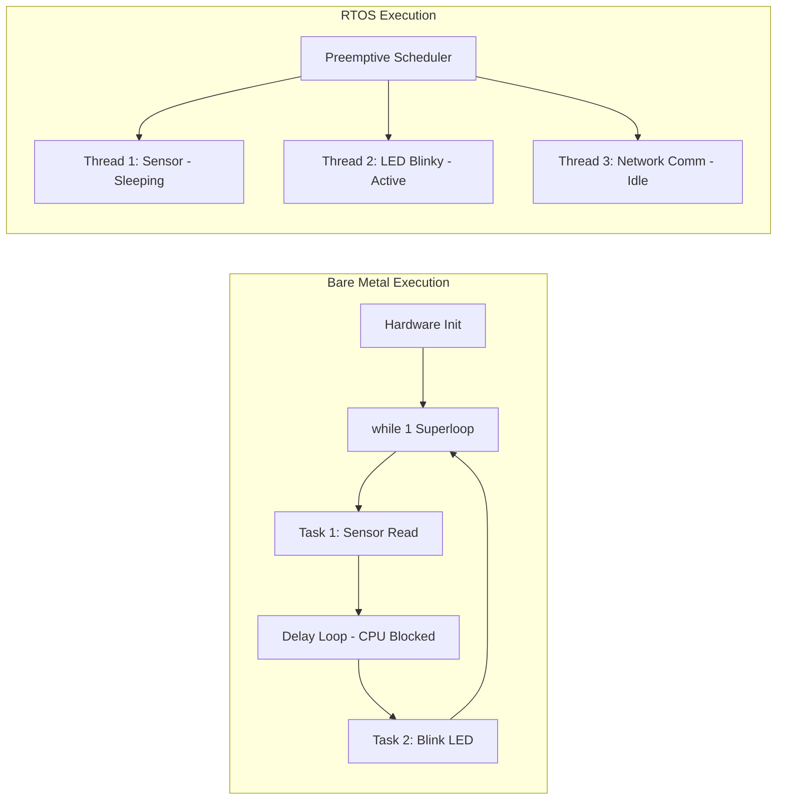
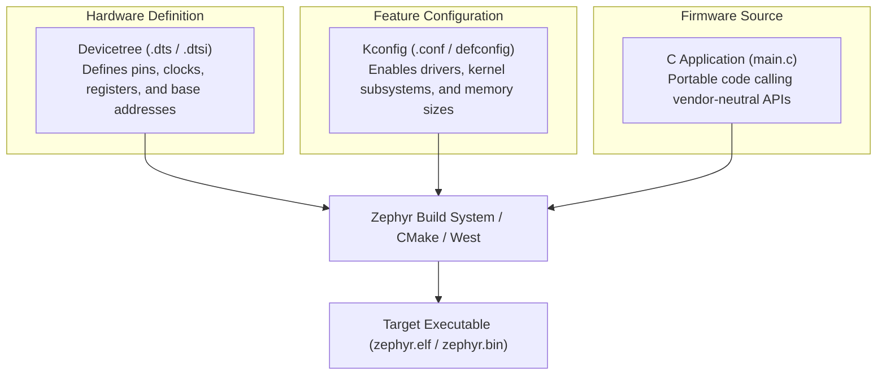

# Comprehensive Student & Beginner's Guide to Zephyr RTOS
## Hands-On Embedded Systems with the Microchip PIC32CM GC00 Curiosity Pro

---

## Table of Contents

1. [Introduction to Zephyr RTOS](#1-introduction-to-zephyr-rtos)
   - [What is an RTOS?](#what-is-an-rtos)
   - [Bare-Metal vs. RTOS](#bare-metal-vs-rtos)
   - [What is Zephyr?](#what-is-zephyr)
   - [Why Was Zephyr Created?](#why-was-zephyr-created)
2. [Why Choose Zephyr? (Purpose & Advantages)](#2-why-choose-zephyr-purpose--advantages)
   - [Core Architecture Pillars: Devicetree & Kconfig](#core-architecture-pillars-devicetree--kconfig)
   - [Industry Comparison: Bare-Metal vs FreeRTOS vs Zephyr](#industry-comparison-bare-metal-vs-freertos-vs-zephyr)
3. [Real-World Applications & Uses](#3-real-world-applications--uses)
4. [Hardware Overview: PIC32CM GC00 Curiosity Pro](#4-hardware-overview-pic32cm-gc00-curiosity-pro)
   - [Board Architecture & Specifications](#board-architecture--specifications)
   - [The Onboard LED & Active-Low Electrical Logic](#the-onboard-led--active-low-electrical-logic)
5. [Complete Development Environment Setup](#5-complete-development-environment-setup)
   - [Step 1: Install Host Operating System Dependencies](#step-1-install-host-operating-system-dependencies)
   - [Step 2: Set Up Python Virtual Environment](#step-2-set-up-python-virtual-environment)
   - [Step 3: Install West (Zephyr's Meta-Tool)](#step-3-install-west-zephyrs-meta-tool)
   - [Step 4: Initialize the Zephyr Workspace](#step-4-initialize-the-zephyr-workspace)
   - [Step 5: Install the Zephyr SDK & Toolchain](#step-5-install-the-zephyr-sdk--toolchain)
   - [Step 6: Configure USB Permissions (Linux udev rules)](#step-6-configure-usb-permissions-linux-udev-rules)
6. [Anatomy of a Zephyr Application](#6-anatomy-of-a-zephyr-application)
   - [Project Structure](#project-structure)
   - [Understanding `CMakeLists.txt`](#understanding-cmakeliststxt)
   - [Understanding `prj.conf` (Kconfig)](#understanding-prjconf-kconfig)
7. [In-Depth Code Walkthrough (`src/main.c`)](#7-in-depth-code-walkthrough-srcmainc)
   - [Header Inclusions & Kernel Services](#header-inclusions--kernel-services)
   - [Preprocessor Timing Constants](#preprocessor-timing-constants)
   - [The Devicetree Node Identifier & Specs](#the-devicetree-node-identifier--specs)
   - [Device Readiness & Hardware Initialization](#device-readiness--hardware-initialization)
   - [Logical vs. Physical Pin States (Active-Low Demystified)](#logical-vs-physical-pin-states-active-low-demystified)
   - [The Blinking Pattern Engine (Nested Loops & Delays)](#the-blinking-pattern-engine-nested-loops--delays)
   - [`k_msleep()` vs. Busy Waiting](#k_msleep-vs-busy-waiting)
8. [Building, Flashing, and Serial Telemetry](#8-building-flashing-and-serial-telemetry)
   - [Step-by-Step Build Commands](#step-by-step-build-commands)
   - [Flashing to the PIC32CM GC00 Board](#flashing-to-the-pic32cm-gc00-board)
   - [Connecting to Serial Monitor (UART)](#connecting-to-serial-monitor-uart)
9. [Student Exercises & Lab Challenges](#9-student-exercises--lab-challenges)
   - [Challenge 1: Morse Code SOS Generator](#challenge-1-morse-code-sos-generator)
   - [Challenge 2: Dual-LED Alternating Flasher](#challenge-2-dual-led-alternating-flasher)
   - [Challenge 3: Pushbutton-Controlled Blinky](#challenge-3-pushbutton-controlled-blinky)
10. [Summary & Key Takeaways](#10-summary--key-takeaways)

---

## 1. Introduction to Zephyr RTOS

### What is an RTOS?
An **RTOS (Real-Time Operating System)** is an operating system specifically engineered to run applications with precise timing constraints and deterministic responsiveness. Unlike general-purpose operating systems (such as Windows, macOS, or standard Linux) that optimize for overall throughput and user experience, an RTOS guarantees that time-critical events and hardware interrupts are serviced within deterministic deadlines.

### Bare-Metal vs. RTOS

When learning embedded systems, students typically start with **Bare-Metal programming**. In bare-metal:
- The firmware consists of a single `main()` function with a large `while(1)` super-loop.
- Delays are frequently implemented using wasteful CPU counting loops (`for (volatile int i = 0; i < 10000; i++);`).
- Concurrency requires complex interrupt service routines (ISRs) and manual state machines.
- Porting code to a different microcontroller vendor requires rewriting register names and hardware peripheral drivers from scratch.



An RTOS introduces a **preemptive scheduler**:
- Tasks run as independent threads, each with its own stack.
- When one thread sleeps (e.g. waiting for $350\text{ ms}$), the CPU switches immediately to other threads or powers down into ultra-low-power idle mode.
- System drivers are standardized across different chip vendors.

### What is Zephyr?
**Zephyr** is an open-source, scalable, real-time operating system governed by the **Linux Foundation**. It is specifically designed for resource-constrained embedded systems and connected Internet-of-Things (IoT) devices, scaling from small $32$-bit microcontrollers with only $8\text{ KB}$ of RAM up to multi-core MPUs with megabytes of memory.

Zephyr is supported and developed by major semiconductor and tech leaders, including **Google, Intel, Microchip, Nordic Semiconductor, NXP, STMicroelectronics, Meta, and Qualcomm**.

### Why Was Zephyr Created?
Traditionally, embedded engineers had to choose between:
1. **Bare-metal SDKs**: Tied to one vendor (e.g., Microchip MPLAB Harmony, STM32Cube), leading to complete vendor lock-in.
2. **Minimal RTOS Kernels (e.g., FreeRTOS)**: Provide scheduling and queues, but lack built-in networking stacks, standardized driver interfaces, or power management frameworks.
3. **Embedded Linux**: Feature-rich, but requires powerful processors (ARM Cortex-A) with tens of megabytes of RAM and boots in seconds rather than milliseconds.

Zephyr bridges this divide: it brings the **modern design paradigms of Linux** (Devicetree, Kconfig, modular drivers, POSIX compliance, unified build system) down to **microcontrollers (ARM Cortex-M)** that cost less than a dollar.

---

## 2. Why Choose Zephyr? (Purpose & Advantages)

### Core Architecture Pillars: Devicetree & Kconfig

Zephyr separates **hardware specification** from **software implementation**:



1. **Devicetree (DTS)**:
   - A hierarchical text file that describes the hardware topology (which GPIO pin is connected to which LED, what frequency the clock runs at, where registers are mapped in memory).
   - Your C source code does not hard-code register addresses like `PORTA->OUT.reg |= (1 << 20)`. Instead, it requests `DT_ALIAS(led0)`!
   - If you switch from a Microchip board to an ST or Nordic board, the C application code remains **$100\%$ unchanged**—only the board Devicetree changes.

2. **Kconfig**:
   - Borrowed directly from the Linux Kernel configuration system.
   - Allows fine-grained compile-time configuration of every subsystem.
   - If your application doesn't need floating-point operations or networking, those code sections are stripped out at compile time, saving precious Flash and RAM.

### Industry Comparison: Bare-Metal vs FreeRTOS vs Zephyr

| Feature | Bare-Metal | FreeRTOS | Zephyr RTOS |
| :--- | :--- | :--- | :--- |
| **Portability Across Vendors** | Extremely Poor (vendor lock-in) | Low (drivers vary by vendor SDK) | **Universal (Standardized Driver API)** |
| **Hardware Abstraction** | Manual register manipulation | Vendor HAL dependent | **Devicetree (DTS) standard** |
| **Configuration Engine** | Manual `#define` in headers | `FreeRTOSConfig.h` | **Kconfig (interactive, granular)** |
| **Networking & Stacks** | Requires third-party ports | External libraries (lwIP, etc.) | **Batteries-included (BLE, Wi-Fi, CAN, TCP/IP, USB)** |
| **Security Certification** | None / manual | Basic | **Engineered for safety (IEC 61508, ISO 26262)** |
| **Power Management** | Manual sleep mode entry | Tickless idle (requires glue code) | **Native Power Management Subsystem** |
| **Build & Package Tool** | Proprietary IDEs | Make / CMake manually configured | **West (unified meta-tool)** |

---

## 3. Real-World Applications & Uses

Zephyr is deployed in millions of production commercial products worldwide:

* **Wearables & Smartwatches**: Fitness trackers and smartwatches running Zephyr on multi-core ARM Cortex-M microcontrollers with Bluetooth Low Energy (BLE).
* **Smart Home & Matter/Thread**: Smart lights, smart locks, and environmental sensors communicating over IEEE 802.15.4 and Matter protocols.
* **Industrial Automation & Robotics**: Factory sensors, motor controllers, and CAN-bus industrial telemetry nodes requiring deterministic timing.
* **Medical Devices**: Portable health monitors, continuous glucose monitoring (CGM) devices, and pulse oximeters requiring high reliability and memory protection unit (MPU) isolation.
* **Automotive Telematics**: Vehicle subsystems communicating via CAN-FD, LIN, and automotive Ethernet.

---

## 4. Hardware Overview: PIC32CM GC00 Curiosity Pro

The **Microchip PIC32CM GC00 Curiosity Pro** is a modern development board featuring the **PIC32CM5112GC00100** microcontroller.

```text
+-------------------------------------------------------------------------------+
|                      PIC32CM GC00 CURIOSITY PRO (EV33A17A)                    |
|                                                                               |
|  [DEBUG USB (EDBG)]                     [PIC32CM5112GC00100]                  |
|  +---------------+                      +------------------+                  |
|  | Micro-B Conn  |                      | ARM Cortex-M23   |     [LED0 Yellow]|
|  | - JTAG/SWD    |==== CMSIS-DAP =====> | 48 MHz, 512KB FL |===> Pin PA20     |
|  | - Virtual COM |==== UART (PA04) ===> | 128 KB SRAM      |                  |
|  +---------------+                      +------------------+     [LED1 Yellow]|
|                                                   ||             Pin PA18     |
|                                            [Pushbutton SW0]                   |
|                                            Pin PB07                           |
+-------------------------------------------------------------------------------+
```

### Board Architecture & Specifications

| Hardware Component | Details & Value | Technical Significance |
| :--- | :--- | :--- |
| **MCU Model** | `PIC32CM5112GC00100` | 100-pin TQFP package |
| **Processor Core** | ARM Cortex-M23 | 32-bit RISC core (ARMv8-M Baseline architecture) |
| **Clock Source** | 48 MHz FDPLL96M | High internal frequency for fast deterministic operations |
| **Internal Flash** | 512 KB | Generous memory for RTOS kernel, stacks, and user code |
| **System SRAM** | 128 KB | Zero-wait-state SRAM for thread stacks and variables |
| **Integrated Debugger** | On-Board nEDBG | Provides CMSIS-DAP programming, J-Link mode, and CDC UART |
| **Primary User LED** | **LED0 (Yellow)** | Connected to Port A, Pin 20 (`PA20`) |
| **Secondary User LED**| **LED1 (Yellow)** | Connected to Port A, Pin 18 (`PA18`) |
| **User Pushbuttons** | SW0 (`PB07`), SW1 (`PB11`) | Active-low mechanical switches with pull-ups |

---

### The Onboard LED & Active-Low Electrical Logic

One of the most important concepts for embedded systems students to understand is the difference between **Active-High** and **Active-Low** circuits:

```text
ACTIVE-HIGH CIRCUIT:
MCU Pin PA20 ----->| [LED] -----/\/\/\-----> GND
(Setting pin HIGH = 3.3V illuminates the LED; Setting pin LOW = 0V turns it OFF)

ACTIVE-LOW CIRCUIT (Used on PIC32CM GC00 Curiosity Pro):
3.3V (VCC) ----->| [LED] -----/\/\/\-----> MCU Pin PA20
(Setting pin LOW = 0V sinks current, turning LED ON; Setting pin HIGH = 3.3V turns LED OFF)
```

#### Why Do Hardware Designers Use Active-Low?
Microcontroller I/O transistors (N-channel MOSFETs) can typically **sink** more current safely to ground ($0\text{ V}$) than they can **source** from supply ($3.3\text{ V}$). Connecting the LED cathode to the pin ensures brighter, safer illumination.

#### How Zephyr Solves the Confusion:
In bare-metal C, you have to remember: *"To turn the LED ON, write 0; to turn it OFF, write 1"*. This often causes bugs.

In Zephyr's Devicetree:
```dts
led0: led_0 {
    gpios = <&porta 20 GPIO_ACTIVE_LOW>;
    label = "LED0";
};
```
Because the flag `GPIO_ACTIVE_LOW` is stored in the Devicetree:
- `gpio_pin_set_dt(&led, 1)` means **"Turn LED to its ACTIVE state (ON)"** $\rightarrow$ Zephyr drives the physical pin **LOW ($0\text{ V}$)**!
- `gpio_pin_set_dt(&led, 0)` means **"Turn LED to its INACTIVE state (OFF)"** $\rightarrow$ Zephyr drives the physical pin **HIGH ($3.3\text{ V}$)**!

You program in pure **logical state** ($1 = \text{ON}, 0 = \text{OFF}$), and Zephyr handles the physics!

---

## 5. Complete Development Environment Setup

Follow these steps to set up your host PC for Zephyr development:

### Step 1: Install Host Operating System Dependencies

#### On Ubuntu / Debian Linux:
```bash
sudo apt update && sudo apt upgrade -y
sudo apt install --no-install-recommends -y \
  git cmake ninja-build gperf ccache dfu-util device-tree-compiler wget \
  python3-dev python3-pip python3-setuptools python3-tk python3-wheel \
  xz-utils file make gcc gcc-multilib g++-multilib libsdl2-dev libmagic1
```

#### On Windows (WSL2 / PowerShell):
- Install **WSL2** (Ubuntu 22.04 or 24.04 LTS) by running `wsl --install` in PowerShell, then follow the Linux instructions inside Ubuntu.

---

### Step 2: Set Up Python Virtual Environment

Create an isolated Python environment to avoid package conflicts:

```bash
# 1. Create a workspace directory
mkdir -p ~/zephyrproject
cd ~/zephyrproject

# 2. Create the Python virtual environment
python3 -m venv .venv

# 3. Activate the virtual environment
source .venv/bin/activate
```

> **Note:** Every time you open a new terminal window to work on Zephyr, remember to run:
> ```bash
> source ~/zephyrproject/.venv/bin/activate
> ```

---

### Step 3: Install West (Zephyr's Meta-Tool)

**West** is Zephyr's command-line Swiss Army knife: it manages git repositories, triggers CMake builds, and launches hardware programmers.

```bash
pip install --upgrade pip
pip install west
```

---

### Step 4: Initialize the Zephyr Workspace

Initialize the Zephyr manifest and download all core repositories and drivers:

```bash
# Initialize west in the current directory
west init -l zephyr

# Download external modules (HALs, CMSIS packs, cryptographic libraries)
west update

# Export Zephyr CMake packages
west zephyr-export

# Install additional Python requirements needed by Zephyr scripts
pip install -r zephyr/scripts/requirements.txt
```

---

### Step 5: Install the Zephyr SDK & Toolchain

The **Zephyr SDK** contains cross-compilers (GCC, binutils, GDB) and host utilities needed to compile ARM binaries on an x86 host:

```bash
cd ~
# Download Zephyr SDK (version 0.16.8 or newer)
wget https://github.com/zephyrproject-rtos/sdk-ng/releases/download/v0.16.8/zephyr-sdk-0.16.8_linux-x86_64.tar.xz

# Extract SDK archive
tar xvf zephyr-sdk-0.16.8_linux-x86_64.tar.xz

# Run the setup script to register the ARM toolchain
cd zephyr-sdk-0.16.8
./setup.sh -t arm-zephyr-eabi -h -c
```

---

### Step 6: Configure USB Permissions (Linux udev rules)

By default, Linux prevents standard non-root users from writing directly to USB debuggers. Install Zephyr's udev rules so `west flash` can communicate with the onboard EDBG debugger without `sudo`:

```bash
sudo cp ~/zephyrproject/zephyr/scripts/udev/rules.d/* /etc/udev/rules.d/
sudo udevadm control --reload-rules
sudo udevadm trigger
```

---

## 6. Anatomy of a Zephyr Application

A standalone Zephyr project consists of three core elements:

```text
pic32cm_gc00_blinky/
├── CMakeLists.txt     <-- Build definition (tells CMake what files to compile)
├── prj.conf           <-- Feature configuration (tells Zephyr what drivers to enable)
└── src/
    └── main.c         <-- C source code (firmware logic)
```

---

### Understanding `CMakeLists.txt`

```cmake
cmake_minimum_required(VERSION 3.20.0)

find_package(Zephyr REQUIRED HINTS $ENV{ZEPHYR_BASE})
project(pic32cm_gc00_blinky)

target_sources(app PRIVATE src/main.c)
```

* `cmake_minimum_required(VERSION 3.20.0)`: Ensures the build engine has modern CMake capabilities.
* `find_package(Zephyr REQUIRED ...)`: **The Magic Line.** Locates Zephyr's build framework, loads the board's Devicetree, pulls in the compiler toolchain, and sets up header search paths.
* `project(pic32cm_gc00_blinky)`: Defines the name of your firmware project.
* `target_sources(app PRIVATE src/main.c)`: Registers `src/main.c` as a compilation source file for the `app` target.

---

### Understanding `prj.conf` (Kconfig)

```ini
CONFIG_GPIO=y
CONFIG_PRINTK=y
CONFIG_STDOUT_CONSOLE=y
```

In Zephyr, hardware drivers are **disabled by default** to minimize code size. `prj.conf` selectively enables only what is needed:

* `CONFIG_GPIO=y`: Compiles Zephyr's GPIO driver subsystem (`drivers/gpio/gpio_mchp_port_g1.c`). Without this, calling `gpio_pin_set_dt()` results in a linker error.
* `CONFIG_PRINTK=y`: Enables Zephyr's lightweight, non-blocking formatted print utility (`printk()`).
* `CONFIG_STDOUT_CONSOLE=y`: Routes the standard C library `printf()` output directly to the UART serial console.

---

## 7. In-Depth Code Walkthrough (`src/main.c`)

Here is the complete source code, followed by a line-by-line pedagogical breakdown:

```c
/*
 * Copyright (c) 2016 Intel Corporation
 * SPDX-License-Identifier: Apache-2.0
 */

#include <stdio.h>
#include <zephyr/kernel.h>
#include <zephyr/drivers/gpio.h>

/* Timing configurations (in milliseconds) */
#define SLEEP_TIME_MS   1000    /* Pause time: 1000 ms (1 second) */
#define ON_TIME         350     /* LED ON time: 350 ms */
#define OFF_TIME        450     /* LED OFF time: 450 ms */

/* The devicetree node identifier for the "led0" alias. */
#define LED0_NODE DT_ALIAS(led0)

/* Retrieve GPIO devicetree specification structure */
static const struct gpio_dt_spec led = GPIO_DT_SPEC_GET(LED0_NODE, gpios);

int main(void)
{
	int ret;
	bool led_state;

	if (!gpio_is_ready_dt(&led)) {
		return 0;
	}

	/* Initialize LED pin as output in INACTIVE (OFF) state */
	ret = gpio_pin_configure_dt(&led, GPIO_OUTPUT_INACTIVE);
	if (ret < 0) {
		return 0;
	}

	while (1) {
		/* Loop 5 times: 350 ms ON, 450 ms OFF */
		for (int i = 0; i < 5; i++) {
			/* Command: Turn LED ON for 350 ms */
			ret = gpio_pin_set_dt(&led, 1);
			if (ret < 0) {
				return 0;
			}
			led_state = true;
			printf("Iteration %d/5 - LED state: %s (350 ms ON)\n", i + 1, led_state ? "ON" : "OFF");
			k_msleep(ON_TIME);

			/* Command: Turn LED OFF for 450 ms */
			ret = gpio_pin_set_dt(&led, 0);
			if (ret < 0) {
				return 0;
			}
			led_state = false;
			printf("Iteration %d/5 - LED state: %s (450 ms OFF)\n", i + 1, led_state ? "ON" : "OFF");
			k_msleep(OFF_TIME);
		}

		/* Command: Pause - LED remains OFF for 1000 ms (1 second) */
		ret = gpio_pin_set_dt(&led, 0);
		if (ret < 0) {
			return 0;
		}
		led_state = false;
		printf("Pause - LED state: %s (1000 ms Pause)\n\n", led_state ? "ON" : "OFF");
		k_msleep(SLEEP_TIME_MS);
	}

	return 0;
}
```

---

### Detailed Section-by-Section Explanation

#### Lines 7–9: Header Inclusions
```c
#include <stdio.h>
#include <zephyr/kernel.h>
#include <zephyr/drivers/gpio.h>
```
* `<stdio.h>`: Provides standard C library input/output functions such as `printf()`.
* `<zephyr/kernel.h>`: The core kernel API header. Exposes thread control, synchronization primitives (semaphores, mutexes), and timing functions like `k_msleep()`.
* `<zephyr/drivers/gpio.h>`: The hardware-independent General Purpose Input/Output (GPIO) driver API.

#### Lines 12–14: Preprocessor Macros
```c
#define SLEEP_TIME_MS   1000    /* Pause time: 1000 ms (1 second) */
#define ON_TIME         350     /* LED ON time: 350 ms */
#define OFF_TIME        450     /* LED OFF time: 450 ms */
```
* Defines the pulse widths and pauses in integer milliseconds.
* **Important C syntax rule**: Never write `#define ON_TIME = 350`! In the C preprocessor, `=` becomes part of the substituted text, which causes syntax errors like `k_msleep(= 350)`.

#### Lines 17–23: Devicetree Binding
```c
#define LED0_NODE DT_ALIAS(led0)
static const struct gpio_dt_spec led = GPIO_DT_SPEC_GET(LED0_NODE, gpios);
```
* `DT_ALIAS(led0)`: Queries the board's Devicetree for the node aliased as `led0`. In `pic32cm_gc00_cpro.dts`, this points to:
  `led0: led_0 { gpios = <&porta 20 GPIO_ACTIVE_LOW>; };`
* `GPIO_DT_SPEC_GET(...)`: Packages all required hardware details at compile time into a `struct gpio_dt_spec`:
  - `port`: A pointer to the Microchip PORTA device driver (`const struct device *port`).
  - `pin`: Pin index number `20`.
  - `dt_flags`: Polarity flags (`GPIO_ACTIVE_LOW`).

#### Lines 30–33: Device Readiness Check
```c
if (!gpio_is_ready_dt(&led)) {
    return 0;
}
```
* Verifies that the PORTA driver was initialized successfully during early system boot. If a hardware fault occurred (e.g. clock failure), this check catches it cleanly.

#### Lines 35–38: Pin Configuration
```c
ret = gpio_pin_configure_dt(&led, GPIO_OUTPUT_INACTIVE);
if (ret < 0) {
    return 0;
}
```
* Configures pin `PA20` as a digital output.
* Sets its initial logical state to `INACTIVE` (LED is OFF when the system powers up).
* If configuration succeeds, `ret` equals `0`. A negative value indicates an error code (e.g., `-EINVAL`).

#### Lines 41–60: The Active 5-Cycle Blinking Loop
```c
for (int i = 0; i < 5; i++) {
    /* Turn LED ON */
    ret = gpio_pin_set_dt(&led, 1);
    ...
    k_msleep(ON_TIME);

    /* Turn LED OFF */
    ret = gpio_pin_set_dt(&led, 0);
    ...
    k_msleep(OFF_TIME);
}
```
1. **Turn ON**: `gpio_pin_set_dt(&led, 1)` drives logical active state ($1$). Because the LED is active-low, Zephyr sets physical pin `PA20` to $0\text{ V}$, turning the LED ON.
2. **Hold**: `k_msleep(ON_TIME)` yields the CPU for $350\text{ ms}$.
3. **Turn OFF**: `gpio_pin_set_dt(&led, 0)` drives logical inactive state ($0$), setting physical pin `PA20` to $3.3\text{ V}$, turning the LED OFF.
4. **Hold**: `k_msleep(OFF_TIME)` yields the CPU for $450\text{ ms}$.
5. The `for` loop repeats this exact sequence **5 times** (total burst time: $5 \times (350 + 450) = 4000\text{ ms}$).

#### Lines 62–70: The Quiescent Rest Pause
```c
ret = gpio_pin_set_dt(&led, 0);
...
k_msleep(SLEEP_TIME_MS);
```
* Ensures the LED is explicitly held OFF.
* Sleeps for $1000\text{ ms}$ (1 second).
* The outer `while(1)` then loops back to the start, repeating the entire 5-second cycle forever.

---

### `k_msleep()` vs. Busy Waiting

Students must understand the fundamental difference between `k_msleep()` and `k_busy_wait()`:

| Characteristic | `k_msleep(ms)` (Used Here) | `k_busy_wait(us)` |
| :--- | :--- | :--- |
| **CPU Behavior** | **Yields CPU to other threads** or enters low-power sleep | **Burns CPU cycles** in a tight loop at 48 MHz |
| **Power Consumption**| Minimal (battery friendly) | Maximum (drains power) |
| **Granularity** | Milliseconds ($1\text{ ms}$ tick resolution) | Microseconds (sub-millisecond precision) |
| **Best Used For** | Human-visible timers, LED blinks, periodic sensor reads | Short microsecond protocol timing (e.g. 1-Wire, I2C bitbang) |

---

## 8. Building, Flashing, and Serial Telemetry

### Step-by-Step Build Commands

1. **Open your terminal and activate your environment**:
   ```bash
   cd ~/zephyrproject
   source .venv/bin/activate
   ```

2. **Clean Build**:
   ```bash
   west build -b pic32cm_gc00_cpro pic32cm_gc00_blinky -p always
   ```
   * `-b pic32cm_gc00_cpro`: Specifies the target board.
   * `-p always`: Performs a pristine clean build, discarding prior CMake caches.

3. **Incremental Rebuild** (after editing code):
   ```bash
   west build -b pic32cm_gc00_cpro pic32cm_gc00_blinky
   ```

---

### Flashing to the PIC32CM GC00 Board

1. Plug a micro-USB cable into the **DEBUG USB** port (J100) of the Curiosity Pro board.
2. Run:
   ```bash
   west flash
   ```
   Zephyr invokes the J-Link / EDBG runner, erases the internal flash, programs `zephyr.bin`, verifies the flash checksums, and issues a hardware reset.

---

### Connecting to Serial Monitor (UART)

The onboard debugger bridges the MCU's UART (`PA04`) to your PC as a USB CDC Virtual COM port.

* **On Linux**: Device is `/dev/ttyACM0` or `/dev/ttyACM1`.
* **On Windows**: Device is `COMx` (check Device Manager).

Use your preferred serial terminal emulator set to **115200 baud, 8 data bits, no parity, 1 stop bit (115200 8N1)**:

#### Using `picocom`:
```bash
picocom -b 115200 /dev/ttyACM0
```

#### Using `minicom`:
```bash
minicom -D /dev/ttyACM0 -b 115200
```

#### Expected Terminal Output:
```text
*** Booting Zephyr OS build v3.7.0 ***
Iteration 1/5 - LED state: ON (350 ms ON)
Iteration 1/5 - LED state: OFF (450 ms OFF)
Iteration 2/5 - LED state: ON (350 ms ON)
Iteration 2/5 - LED state: OFF (450 ms OFF)
Iteration 3/5 - LED state: ON (350 ms ON)
Iteration 3/5 - LED state: OFF (450 ms OFF)
Iteration 4/5 - LED state: ON (350 ms ON)
Iteration 4/5 - LED state: OFF (450 ms OFF)
Iteration 5/5 - LED state: ON (350 ms ON)
Iteration 5/5 - LED state: OFF (450 ms OFF)
Pause - LED state: OFF (1000 ms Pause)

Iteration 1/5 - LED state: ON (350 ms ON)
Iteration 1/5 - LED state: OFF (450 ms OFF)
...
```

---

## 9. Student Exercises & Lab Challenges

To solidify your understanding of Zephyr RTOS, complete the following three hands-on laboratory exercises:

### Challenge 1: Morse Code SOS Generator
Modify the timing parameters in `src/main.c` to transmit the international distress signal **SOS** in Morse code on LED0:
- **S** ($3$ short pulses): $150\text{ ms}$ ON, $150\text{ ms}$ OFF
- **O** ($3$ long pulses): $450\text{ ms}$ ON, $150\text{ ms}$ OFF
- **S** ($3$ short pulses): $150\text{ ms}$ ON, $150\text{ ms}$ OFF
- **Word Pause**: $2000\text{ ms}$ OFF

---

### Challenge 2: Dual-LED Alternating Flasher
The PIC32CM GC00 Curiosity Pro features a second LED (**LED1**) connected to pin `PA18`.
1. Inspect `pic32cm_gc00_cpro.dts` and locate `led1 = &led1;`.
2. In C, create a second spec:
   ```c
   #define LED1_NODE DT_ALIAS(led1)
   static const struct gpio_dt_spec led1 = GPIO_DT_SPEC_GET(LED1_NODE, gpios);
   ```
3. Configure `led1` and alternate them like an emergency vehicle beacon: when `led0` is ON, `led1` is OFF; when `led0` is OFF, `led1` is ON.

---

### Challenge 3: Pushbutton-Controlled Blinky
The board has a mechanical pushbutton (**SW0**) connected to pin `PB07` (`DT_ALIAS(sw0)`).
1. Look up the devicetree alias `sw0`.
2. Configure `sw0` as an input with internal pull-up using `GPIO_INPUT`.
3. Modify the program so the 5-pulse blink pattern only runs when the button is held pressed; when the button is released, the LED must remain completely OFF.

---

## 10. Summary & Key Takeaways

1. **Zephyr is Architecture-Agnostic**: It provides a unified driver API. Code written for a Microchip Cortex-M23 runs identically on STM32, NXP, or Nordic chips.
2. **Devicetree (DTS) Decouples Hardware from Code**: Pin definitions and base addresses live in `.dts` files, never in application C code.
3. **Kconfig Minimizes Footprint**: Drivers and subsystems are modularly enabled via `prj.conf`.
4. **Logical Levels Abstract Circuit Inversions**: `gpio_pin_set_dt(&spec, 1)` activates the peripheral regardless of whether the physical circuit is active-high or active-low.
5. **Preemptive Multitasking Saves Power**: `k_msleep()` allows the kernel scheduler to put the CPU into low-power states between blink events.
